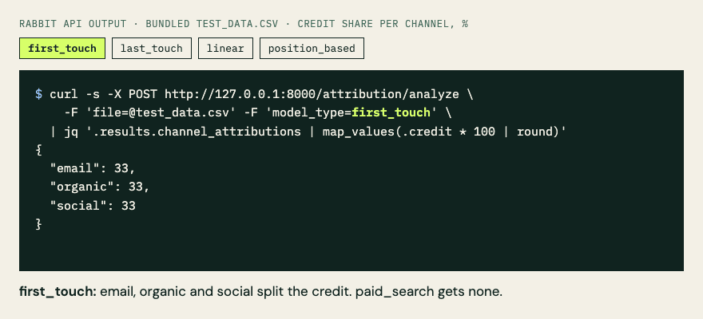

<p align="center">
  
</p>

<h1 align="center">Rabbit</h1>

<p align="center">
  <strong>The attribution model you pick moves your budget. See by how much before you commit to one.</strong>
</p>

<p align="center">
  5 rule-based attribution models · self-hosted API · CSV of touchpoints in, each channel's credit share out
</p>

<p align="center">
  <a href="https://github.com/ChristopherLandaverde/rabbit/actions/workflows/ci.yml"></a>
  <a href="LICENSE"></a>
</p>

<p align="center">
  <a href="#quick-start">Quick start</a> · <a href="#same-data-five-models">Same data, five models</a> · <a href="#known-limits">Known limits</a> · <a href="#status">Status</a> · <a href="docs/usage.md">Usage guide</a>
</p>

On the bundled sample of 10 touchpoints, email gets **33%** of conversion credit under first-touch and **67%** under last-touch. Same data, same conversions; only the model changed.

Rabbit is a small self-hosted API for marketing analysts and RevOps people choosing or defending an attribution model, and for engineers who want an attribution endpoint they run themselves. Post a CSV of touchpoints; get each channel's share of conversion credit under first-touch, last-touch, linear, time-decay or position-based. Results describe attribution under the named model; they do not estimate causal impact.

**Status: paused for new features** after the v2 tracer slice (milestones M0–M3a). The v1 API is the supported path; see [Status](#status).

## Same data, five models

<p align="center">
  
  <br><sub>Real API responses on the bundled <code>test_data.csv</code>, one model per frame, from the quick-start request below. Channels with no credit are left out; <code>time_decay</code> is skipped because it matches <code>linear</code> on this sample.</sub>
</p>

Share of conversion credit per channel on `test_data.csv` (3 customers, 10 touchpoints, 3 conversions), real API output rounded to whole percent:

| Channel | `first_touch` | `last_touch` | `linear` | `time_decay` | `position_based` |
|---|---:|---:|---:|---:|---:|
| email | 33% | **67%** | 39% | 39% | 47% |
| organic | 33% | 33% | 22% | 22% | 27% |
| social | 33% | 0% | 19% | 19% | 17% |
| paid_search | 0% | 0% | 19% | 19% | 10% |

Paid search touched 2 of the 3 journeys and gets nothing under either single-touch model. Social drops from a third of the credit to zero between first-touch and last-touch. If you set budgets from one model without looking at the others, that swing goes in unexamined. (`time_decay` matches `linear` here because the sample's journeys last 3 hours or less against a 7-day default half-life; see the [usage guide](docs/usage.md#attribution-models).)

## What you get

- **The spread across models, on your own data.** Run one CSV through all five rule-based models and see which channels' credit depends on the model choice.
- **Credit and revenue per channel.** Each response gives every channel's share of credit, the revenue that share represents, and a confidence score.
- **Assumptions you can change.** Set the time-decay half-life and the position-based first/last weights per request.
- **Journeys built from raw touchpoints.** Rabbit links rows by `customer_id`, falling back to session + email or email alone.
- **Runs on your machine.** You start the server; your CSV goes to it, and the v1 code makes no outbound network calls.

## Who it's for

- **Marketing analysts** deciding which attribution model to report on, who want to see what each one does to channel credit first.
- **RevOps leads** defending a model choice, who need to show what the alternatives would have said.
- **Engineers** who need a small attribution API to run locally or behind their own tooling.

## Quick start

Requires Python 3.12, [`uv`](https://docs.astral.sh/uv/) ([pip alternative](docs/usage.md#install-with-pip-instead-of-uv)) and `jq` for the last step.

```bash
git clone https://github.com/ChristopherLandaverde/rabbit.git
cd rabbit
uv venv --python 3.12 .venv
uv pip install --python .venv/bin/python -r requirements.txt
source .venv/bin/activate
python run.py
```

The API listens on `http://localhost:8000`. In a second terminal, from the repo root, run the bundled sample through all five models:

```bash
for model in first_touch last_touch linear time_decay position_based; do
  printf '%-15s' "$model"
  curl -s -X POST http://127.0.0.1:8000/attribution/analyze \
    -F 'file=@test_data.csv' -F "model_type=$model" \
    | jq -c '.results.channel_attributions | map_values(.credit * 100 | round)'
done
```

You should see the table above, as percent of credit per channel (channels with no credit are left out):

```text
first_touch    {"email":33,"organic":33,"social":33}
last_touch     {"email":67,"organic":33}
linear         {"email":39,"paid_search":19,"social":19,"organic":22}
time_decay     {"email":39,"paid_search":19,"social":19,"organic":22}
position_based {"email":47,"paid_search":10,"social":17,"organic":27}
```

Then swap in your own file. The [usage guide](docs/usage.md) covers the input columns, model parameters and the full response; interactive API docs are at <http://localhost:8000/docs>.

## Known limits

- **Credit is association, not causation.** The `insights` block in each response (for example "Increase budget allocation to email by 20-30%") is generated by fixed rules from the credit shares and sample size. Treat it as a prompt for investigation, not a recommendation backed by an experiment.
- **One model per request.** Comparing models means one request per model, as in the quick start; there is no built-in side-by-side comparison yet.
- **Rule-based models only.** No data-driven (Markov, Shapley) model, no cross-device stitching beyond the identifier columns in the CSV, no ad-platform connectors.
- **Redis is optional but reported.** Without Redis on `localhost:6379`, analysis still works but `/health` returns HTTP 200 with `"status": "unhealthy"`.
- **Not deployed or published.** There is no hosted instance and no package; run it locally.
- **Frontend and Docker are not the supported path.** The React app in `frontend/` builds in CI, and Docker Compose files exist, but neither was verified for this README.
- **Known test failures are tracked, not hidden.** The v1 suite has pre-existing failures marked as strict xfails in [`tests/known_failures.txt`](tests/known_failures.txt), with reasons in [docs/b0-baseline.md](docs/b0-baseline.md).

## Status

Paused for new features after the v2 tracer slice (M0–M3a), by the owner's decision of 2026-10-29. Dependency and bug fixes still land. The v1 API above is the supported path. A v2 API (API keys, dataset upload, async single-model analysis) is merged up to milestone M3a behind `RABBIT_V2_ENABLED=true` and needs Postgres and Redis. Planned and not built: multi-model comparison in one call (M3b) and everything after it, including webhooks, an SDK and a deployment ([roadmap](docs/business/ROADMAP.md), [plan](docs/business/PLAN_v2.md)).

## Development

```bash
source .venv/bin/activate
python -m pytest -q --ignore=tests/v2
```

CI runs this v1 suite and the v2 suite on pushes to `main` and on pull requests; see [docs/usage.md](docs/usage.md#development) for both commands, current results and the frontend build. Contributor and agent conventions are in [AGENTS.md](AGENTS.md).

## License

[MIT](LICENSE)
